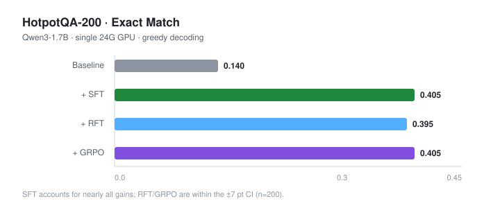

# agentrl-search

**Teaching a 1.7B model to search before it answers.**

A single-GPU post-training pipeline for a multi-hop retrieval agent: data distillation →
LoRA SFT → rejection-sampling FT / GRPO → evaluation. Built on Qwen3-1.7B and a local
BM25 index, it lifts HotpotQA EM from **0.140 to 0.405** on a 200-question benchmark
for roughly **¥30 of GPU time**.



---

## What the agent does

```
Q: Who directed the film whose lead actor was born in 1937 and won an Oscar?
A: <tool_call>{"name":"search","arguments":{"query":"film director Oscar winner"}}</tool_call>
T: [1] The Human Stain: ... Anthony Hopkins ...
A: <tool_call>{"name":"search","arguments":{"query":"Anthony Hopkins born 1937"}}</tool_call>
T: [1] Anthony Hopkins: born 31 December 1937 ...
A: <answer>Anthony Hopkins</answer>
```

The model learns three things that a base checkpoint cannot do:

1. **emit a search call** in a strict text protocol instead of hallucinating;
2. **search again** when the first hop only yields an intermediate entity;
3. **stop and answer** only after the evidence is in context.

---

## Results

| Stage | EM | F1 | `<answer>` rate | tool calls |
|---|---|---|---|---|
| Qwen3-1.7B baseline | 0.140 | 0.225 | 0.745 | 1.62 |
| **+ LoRA SFT** | **0.405** | **0.531** | **0.960** | **2.21** |
| + RFT (rejection sampling) | 0.395 | 0.525 | 0.980 | 2.19 |
| + GRPO (Dr.GRPO loss) | 0.405 | 0.536 | 0.965 | 2.19 |

- Retrieval is **not** the bottleneck: `tool_hit_rate` is 0.92, and the 2×2 breakdown
  (retrieved × correct) shows 111 failures where the gold passage *was* retrieved.
- SFT alone captures essentially all of the gain; RFT and GRPO land inside the
  ±7 point confidence interval of a 200-question eval.
- Every number is reproducible with the scripts below; see [`docs/experiments.md`](docs/experiments.md).

---

## Architecture

```
HotpotQA parquet
      │  normalize (3 different `context` layouts)
      ▼
corpus.jsonl (66,581 passages) ──► BM25 index ──► SearchEnv (search / calculator)
      │                                              ▲
questions.jsonl ──► split(eval200 / rl1200 / sft2000)│
      │                                              │
      ├──► trajectory distillation (DeepSeek) ──► SFT ──► eval
      │                                             │
      │                                             ├──► RFT  (sample → filter → SFT)
      │                                             └──► GRPO (group-relative RL)
      ▼
  metrics + bad-case taxonomy + 2×2 retrieval/reasoning breakdown
```

Design rule: **training, evaluation and data generation share one prompt, one parser and
one environment**. Format changes therefore happen in exactly one place.

---

## Quickstart

```bash
git clone <this-repo> && cd agentrl-search
bash scripts/setup_gpu.sh                 # venv + deps + Qwen3-1.7B (ModelScope)

# 1. data: download + corpus + splits  (~2 min)
mkdir -p data/raw
curl -L -o data/raw/hotpot_dev.parquet \
  "https://hf-mirror.com/datasets/hotpotqa/hotpot_qa/resolve/main/distractor/validation-00000-of-00001.parquet"
python scripts/build_data.py --parquet data/raw/hotpot_dev.parquet --out data/processed
python scripts/eval_retrieval.py          # gate: Recall@5 ≈ 0.695, AllHit@5 ≈ 0.44

# 2. SFT (needs DEEPSEEK_API_KEY; ~¥6 of API)
python scripts/gen_sft_deepseek.py --type B --n 2600 --out data/sft/raw_b.jsonl
python scripts/gen_sft_deepseek.py --type A --n 1200 --out data/sft/raw_a.jsonl
python scripts/gen_sft_deepseek.py --type C --n 400  --out data/sft/raw_c.jsonl
python scripts/validate_sft.py --inputs data/sft/raw_*.jsonl
python scripts/train_sft.py --model Qwen/Qwen3-1.7B --out artifacts/sft_1p7b

# 3. evaluate (single 24G GPU, ~8 min)
python scripts/merge_lora.py --base Qwen/Qwen3-1.7B \
    --adapter artifacts/sft_1p7b/final --out artifacts/sft_1p7b/merged
python scripts/evaluate.py --model artifacts/sft_1p7b/merged --out artifacts/eval_sft
```

Optional second stage:

```bash
# rejection sampling fine-tuning
python scripts/rft_generate.py --model artifacts/sft_1p7b/merged --k 3 --limit 500
python scripts/validate_sft.py --inputs data/rft/raw.jsonl --train data/rft/train.jsonl
python scripts/train_sft.py --model artifacts/sft_1p7b/merged --epochs 1 --lr 5e-5 \
    --train data/rft/train_mixed.jsonl --out artifacts/rft_1p7b

# GRPO (Dr.GRPO + truncation masking + tool-budget reward)
python scripts/train_grpo.py --model artifacts/sft_1p7b/merged --steps 40 --no-vllm \
    --max-completion 2048 --max-turns 3 --lr 1e-6 --lam 0.02 \
    --mask-truncated --loss-type dr_grpo --entropy-coef 0.001
```

---

## Repository layout

```
src/agentrl/
  data/         normalize.py (3 layouts), build.py (corpus, splits)
  retrieval/    bm25.py (Unicode tokenizer, title-aware index)
  env/          search_env.py (TRL-compatible tool environment)
  eval/         runner.py (multi-turn loop), metrics.py, badcase.py
  reward/       rewards.py (EM/F1, format, tool budget)
  prompts.py    single source of truth for the protocol

scripts/
  build_data.py          parquet → corpus/questions/splits
  eval_retrieval.py      Recall@k gate
  gen_sft_deepseek.py    trajectory distillation (+ --fake offline mode)
  validate_sft.py        replay + filter + train/val split
  train_sft.py           LoRA SFT (assistant-only loss, mask preflight)
  rft_generate.py        rejection sampling (HF backend)
  train_grpo.py          GRPO with tool-budget reward
  merge_lora.py          adapter → standalone model
  evaluate.py            greedy multi-turn evaluation
  setup_gpu.sh           fresh-box bootstrap

docs/
  report.md        full project report (design → failures → analysis)
  experiments.md   E0–E10 log with every metric
  resume.md        résumé bullets + 15 interview Q&As
```

---

## Why these choices

| Decision | Reason |
|---|---|
| **BM25, not a dense retriever** | zero cost, deterministic, and its failure mode (lexical mismatch) is exactly what multi-hop query rewriting must fix. Single-shot `AllHit@5 = 0.44` is the project's core argument for an agent loop. |
| **Text protocol, not native function calling** | one parser shared by training, eval and distillation; the model only ever needs to emit `<tool_call>{json}</tool_call>`. |
| **LoRA, not full fine-tuning** | full FT of 1.7B needs ~23 GB and would overfit 1.8k trajectories; LoRA r=32 runs in 9 GB and keeps the adapter at 144 MB. |
| **Assistant-only loss** | tool observations are external text; training on them teaches the model to paraphrase search results instead of answering. |
| **Distillation with a real environment** | the teacher must see real BM25 output, otherwise training and inference distributions diverge. |
| **200-question eval with reported CI** | ±7 points at n=200; the report never claims significance for 1–2 point differences. |

---

## Failure log (short version)

1. **HF Xet 401** on mirror downloads → disabled Xet, switched to ModelScope.
2. **DeepSeek 422** on `role: tool` without `tool_call_id` → teacher sees
   `[TOOL OUTPUT]` as a user message; the saved dataset still uses `role: tool`.
3. **TRL tool loop mismatch** — TRL parses structured `tool_calls`, our data is text.
   The second turn degenerated into `<tool_call>{"`.
4. **Tool results overflow `max_completion_length`** (256) → TRL silently drops them,
   reward stays at −0.025. Raised to 2048.
5. **37.5% truncated completions** polluted gradients → `mask_truncated_completions`.
6. **GRPO reward hacking** with λ=0.1: the policy reduced tool calls (2.21 → 2.03)
   instead of improving answers. λ lowered to 0.02.

Details in [`docs/report.md`](docs/report.md) §10 and §12.

---

## Cost

| Item | Cost |
|---|---|
| Trajectory distillation (4,200 samples, off-peak) | ¥5.5 |
| GPU (SFT + RFT + GRPO + 4 evals, 24G single card) | ≈ ¥24 |
| **Total** | **≈ ¥30** |

---

## Limitations

- Corpus covers only the dev-set distractor passages (66k), not full Wikipedia.
- 200 questions → ±7 pt CI; RL variants are statistically indistinguishable from SFT.
- Trajectory-level reward only; no step-level credit assignment.
- Single-card batch of 16 makes GRPO's group baseline noisy.

---

## Docs

- [Project report](docs/report.md) — 14 chapters, from task selection to reproduction
- [Experiment log](docs/experiments.md) — E0–E10, every metric and regression
- [Résumé material](docs/resume.md) — bullets, 15 interview Q&As, one-minute pitch
